# XAFSView 간단 사용 설명서

XAFSView 0.2.0 기준입니다. PLS-II 10C 빔라인에서 측정한 XAFS 데이터를
μ(E) 생성 → 배경 제거(AUTOBK) → EXAFS 피팅(FEFFIT) → in-situ 맵까지
처리하는 핵심 흐름만 다룹니다. 세부 옵션은 프로그램 안에서 항목 위에 마우스를
올리면 나오는 설명을 참고하세요.

## 1. 설치와 실행

- **Windows**: [릴리스 페이지](https://github.com/physwkim/feffit-rs/releases)에서
  `xafsview-windows-x86_64.zip`을 받아 아무 폴더에나 풀고 `xafsview.exe`를
  실행합니다. 설치 과정이 없습니다. FEFF8L 실행 파일(`feff8l/win64/`)도 같이
  들어 있습니다.
- **Linux / macOS**: 소스에서 빌드합니다 (Rust 1.95 이상).

    ```sh
    cargo run -p xafsview --release
    ```

- FEFF 계산기는 두 가지입니다. **FEFF10**은 프로그램 안에 내장되어 있어 기본값이고,
  **FEFF8L**은 함께 배포되는 외부 실행 파일을 호출합니다. Feff 탭에서 고릅니다.

## 2. 화면 구성

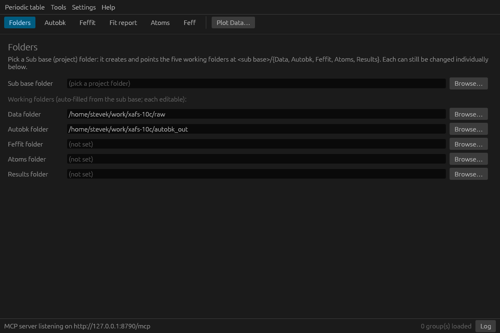

- **메뉴**: Periodic table(주기율표), Tools(도구 모음), Settings(글꼴·테마·MCP),
  Help(About).
- **탭**: Folders → Autobk → Feffit → Fit report → Atoms → Feff. 왼쪽부터
  일상적인 작업 순서입니다. 오른쪽의 **Plot Data…** 버튼은 파일 겹쳐 보기 창을
  엽니다.
- **상태 표시줄**(맨 아래): 마지막 작업 결과와 불러온 group 수. **Log** 버튼으로
  전체 기록을 봅니다.
- 팝업 창(Plot Data, In-situ map, Edit μ(E) 등)은 모두 독립된 OS 창이라 메인 창
  밖으로 옮겨 놓고 쓸 수 있습니다.

## 3. 작업 폴더 (Folders 탭)

**Sub base folder**에서 프로젝트 폴더 하나를 고르면 그 아래에 `Data`, `Autobk`,
`Feffit`, `Atoms`, `Results` 다섯 폴더가 만들어지고 각 작업 폴더로 지정됩니다.
필요하면 폴더마다 따로 바꿀 수 있습니다. 폴더 설정은 다음 실행 때도 유지됩니다.

| 폴더 | 들어가는 것 |
| --- | --- |
| Data | 원본 스캔 파일, 여기서 만든 `*.xmu` |
| Autobk | `*k.chi`, `*r.chi`, `*.bkg` (배경 제거 결과) |
| Feffit | `*k.dat` / `*r.dat` / `*q.dat`, `*.fit` (피팅 결과). 비어 있으면 Data 폴더에 저장 |
| Atoms | `feff.inp`, FEFF가 만든 `feffNNNN.dat` |
| Results | Plot Data·In-situ map 등에서 내보낸 파일 |

## 4. 데이터 열기와 μ(E) 만들기

Autobk 탭에서 **Open New file**을 누르면 아래 창이 뜹니다.

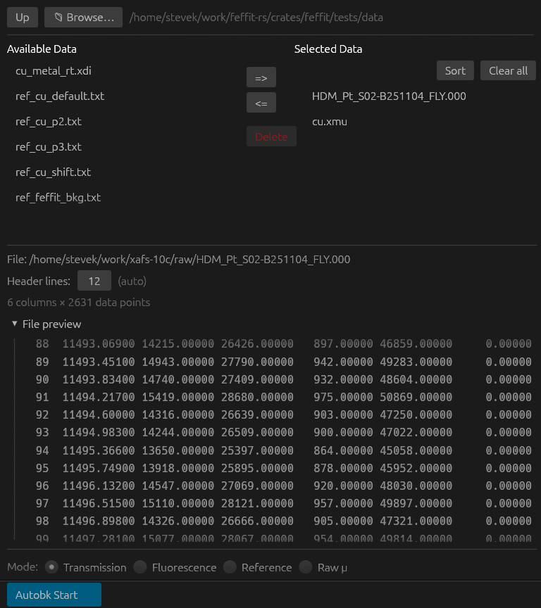

1. 위쪽: Data 폴더의 원본 스캔 파일 목록입니다. **Up** / 하위 폴더 / **Browse…**로
   이동하고, 파일을 골라 `=>`로 오른쪽 **Selected Data**에 넣습니다. 잘못 넣은
   것은 `<=`로 뺍니다.
2. 아래쪽: 읽기 형식입니다. 헤더 줄 수, 열 수, 데이터 미리보기, **Mode**
   (Transmission / Fluorescence / Reference / Raw μ)와 열 역할(에너지, I0, IT …)이
   파일 헤더에서 자동으로 채워집니다. 10C 파일은 보통 그대로 두면 됩니다.
3. **Autobk Start**를 누르면 선택한 파일마다 μ(E)를 만들어 **group**으로 등록하고
   `*.xmu`로 저장한 뒤, 곧바로 배경 제거까지 끝냅니다.

여러 파일을 한꺼번에 넣으면 첫 파일의 열 설정이 모두에 적용됩니다. in-situ
시리즈는 이렇게 한 번에 여는 것이 편합니다. 이미 만들어 둔 `*.xmu`도 같은 방법으로
엽니다.

## 5. 배경 제거 (Autobk 탭)

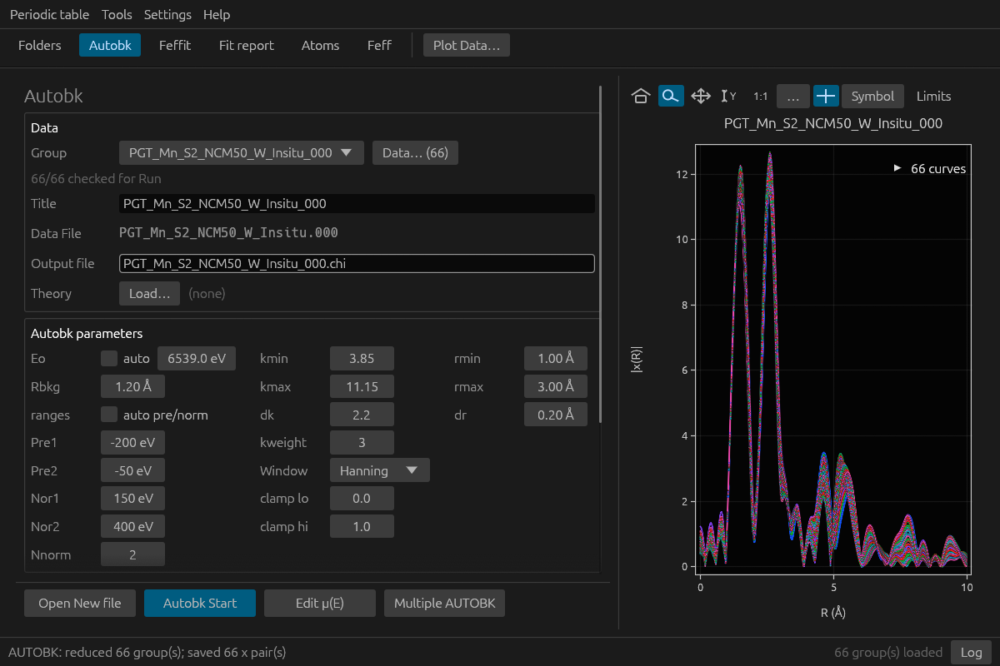

- **Data** 묶음: 현재 group을 고르는 드롭다운과 **Data…** 버튼. Data 창에서
  group을 지우거나 순서를 바꾸고, group마다 **Run 체크**를 켜고 끕니다. 체크는
  일괄 작업(Edit μ(E)의 "Remove in N checked groups", Feffit의 Batch)의
  대상을 정합니다.
- **Autobk parameters**: E₀(auto 또는 직접 입력), Rbkg, pre-edge/normalization
  범위(auto 또는 Pre1·Pre2·Nor1·Nor2·Nnorm), 푸리에 변환 창(kmin, kmax, dk,
  kweight, Window), 역변환 창(rmin, rmax, dr).
- **Autobk Start**: 현재 group을 처리해 χ(k), χ(R)을 계산하고 `*k.chi`,
  `*r.chi`, `*.bkg`를 Autobk 폴더에 저장합니다.
- **Multiple AUTOBK**: 불러온 모든 group을 지금 파라미터로 일괄 처리하고 각각
  저장합니다.

그래프는 **Graph type**으로 바꿉니다. `XMU + BKG`(μ(E)와 배경), `*K.CHI`(kʷχ(k)),
`*R.CHI`(|χ(R)|), `*Q.CHI`, 미분 그래프, `Normalize`(정규화 μ(E)).

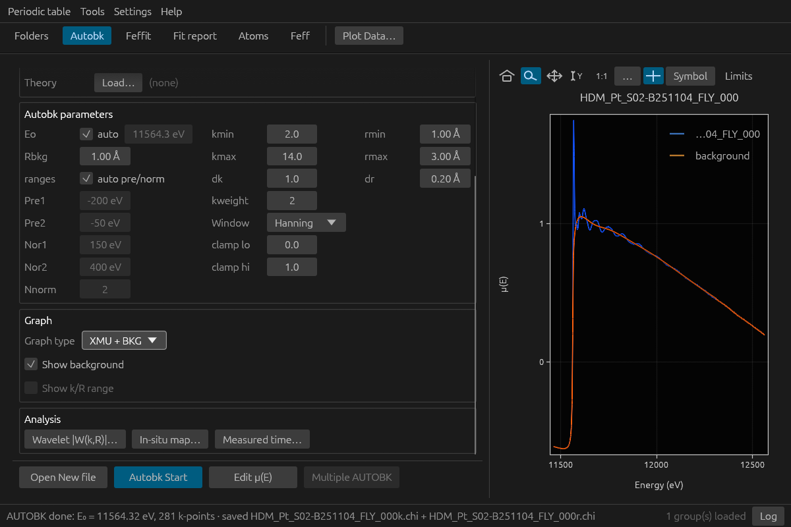

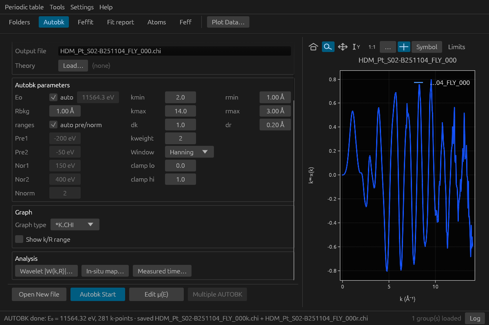

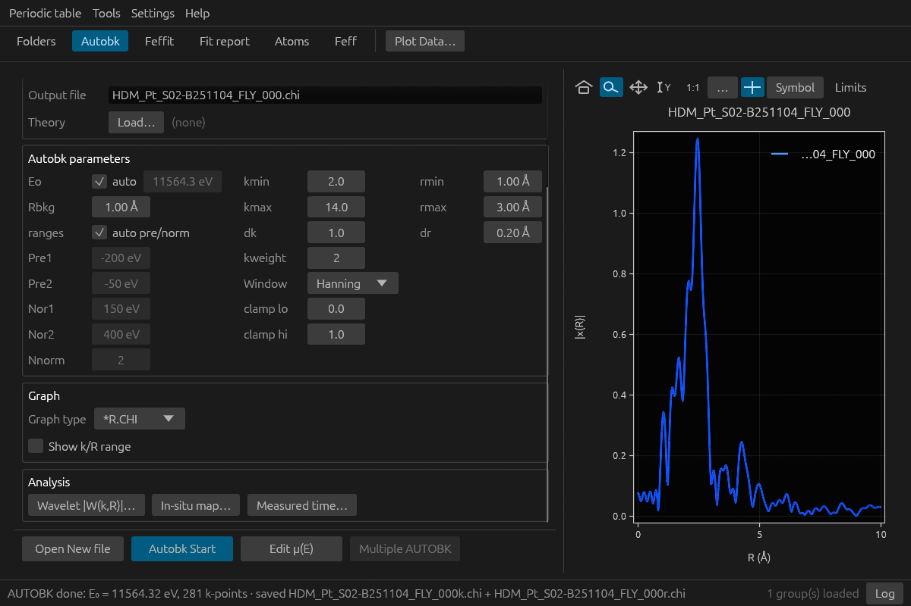

**Show all groups**를 켜면 불러온 group을 전부 겹쳐 그리고, **Stacking** 값으로
위아래 간격을 둡니다.

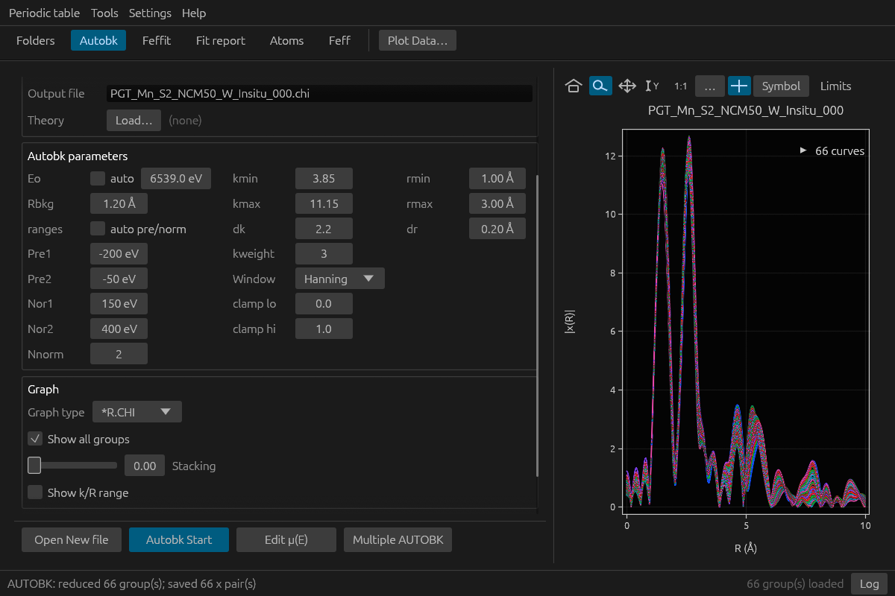

그래프 툴바는 모든 그래프에서 같습니다. 확대·축소·되돌리기(Zoom back), 이동(Pan),
`…`(그 밖의 그래프 설정), 십자선, **Symbol**(데이터 점 표시), **Limits**(축 범위를
숫자로 입력하는 줄). 마우스 휠로도 확대·축소합니다. `*K.CHI` 그래프의 음영 띠는
FT 창(kmin–kmax), `*R.CHI`의 띠는 R 창이며, 띠 가장자리를 끌어 범위를 바꿀 수
있습니다.

## 6. 글리치 제거·자르기·스무딩 (Edit μ(E))

Autobk 탭의 **Edit μ(E)** 버튼(또는 Tools 메뉴)으로 엽니다.

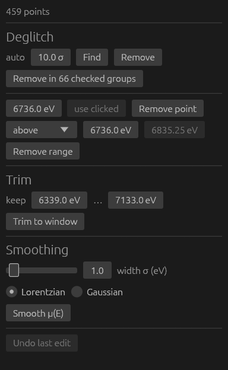

- **Deglitch**: **Find**가 튀는 점을 자동으로 찾고(기준 nσ), **Remove**가 지웁니다.
  **Remove in N checked groups**는 체크한 group 전부에 적용합니다. 점 하나는
  에너지를 입력하거나 그래프에서 클릭한 뒤 **use clicked**로 지정해 **Remove
  point**, 구간은 **Remove range**로 지웁니다.
- **Trim**: 지정한 에너지 구간만 남깁니다.
- **Smoothing**: Lorentzian 또는 Gaussian 폭(σ, eV)으로 스무딩합니다.
- **Undo last edit**로 되돌립니다. 편집 뒤에는 **Autobk Start**를 다시 눌러 χ를
  갱신하세요.

## 7. 파일 겹쳐 보기 (Plot Data)

탭 줄 오른쪽의 **Plot Data…**로 엽니다. 디스크의 결과 파일을 골라 겹쳐 그리는
창입니다.

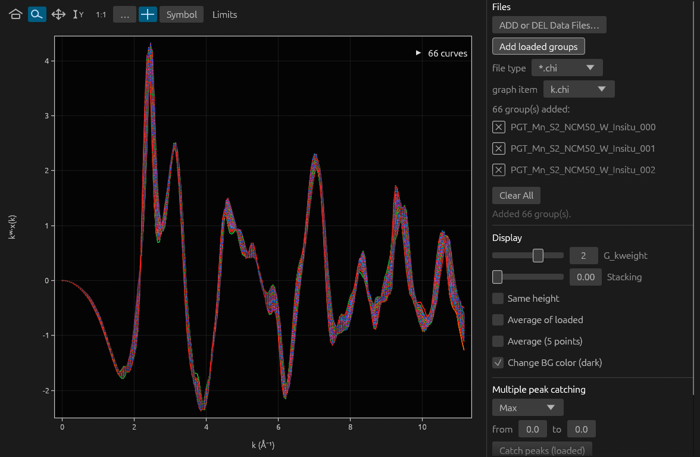

- **ADD or DEL Data Files…**: file type(`*.xmu`, `*.chi`, `*.dat`, `*.fit`,
  `*.bkg`, `*.result`, raw data)과 graph item(`k.chi`, `r.chi` …)을 고른 뒤
  파일을 선택합니다. raw data는 μ(E)를 만들기 전의 원본 스캔 채널(I0, IT 등)을
  그대로 그려 스캔 상태를 확인하는 용도입니다.
- **Add loaded groups**: 지금 메모리에 있는 group을 전부 추가합니다.
- **Display**: k-weight, Stacking, Same height(높이 맞춤), 평균, 5점 스무딩,
  배경색.
- **Multiple peak catching**: 지정 구간에서 곡선마다 최대(Max)·최소(Min) 위치
  또는 지정한 y값을 지나는 x(x at y)를 표로 뽑습니다.
- **Save in single file…**: 그려진 곡선을 한 파일(Origin에서 바로 읽는 형식)로
  저장합니다.

## 8. EXAFS 피팅 (Feffit 탭)

준비물은 두 가지입니다. 배경 제거가 끝난 group의 χ(k), 그리고 FEFF가 만든 산란
경로 파일 `feffNNNN.dat`(9장 참고).

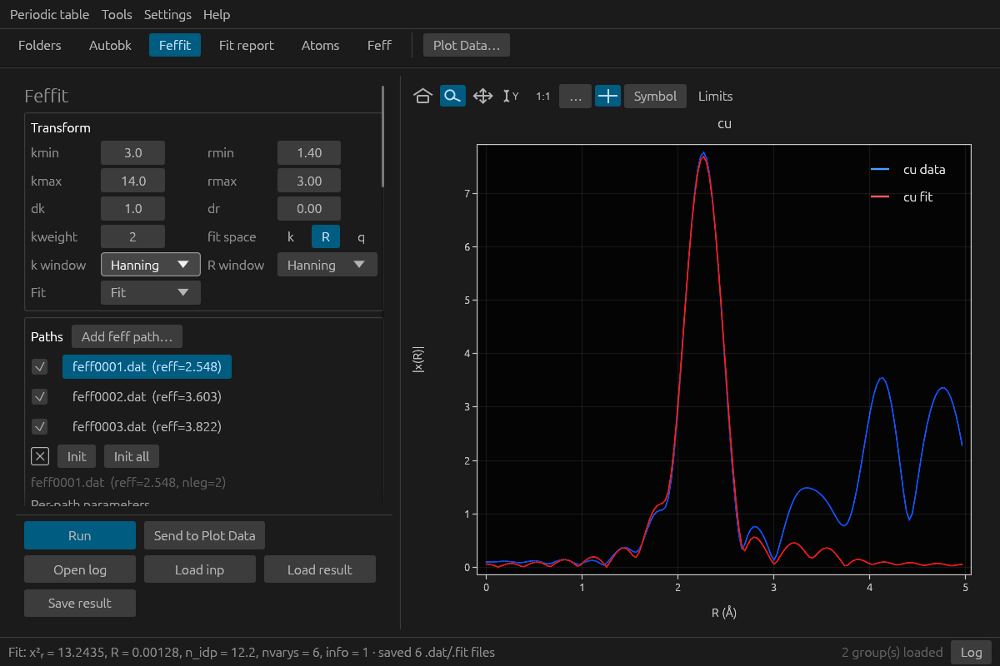

1. **Transform**: 피팅에 쓸 k 창(kmin, kmax, dk, kweight, 창 함수)과 R 범위(rmin,
   rmax, dr), fit space(k / R / q)를 정합니다.
2. **Paths › Add feff path…**로 경로 파일을 추가합니다. 체크 상자로 피팅에
   넣을 경로를 고릅니다.
3. 경로 하나를 고르면 아래에 **Per-path parameters**(N, σ², third, fourth)와
   공통 **Wiring**이 나옵니다. 각 값은 `guess`(피팅 변수), `set`(고정),
   식(다른 변수로 표현) 중 하나입니다. 기본 연결은 진폭 = amp·N, E₀ 이동 =
   del_e0, ΔR = alpha·reff, σ²는 경로마다 따로 변수입니다.
4. **Fit** 드롭다운: `Fit`(최소제곱 피팅), `No fit`(현재 값으로 모델만 계산),
   `Only FT`(데이터만 변환).
5. **Run**. 그래프에 data와 fit이 겹쳐 그려지고, 상태 표시줄에 χ²ᵣ, R-factor,
   독립 변수 수가 나옵니다. 결과 파일은 Feffit 폴더에 저장됩니다.

전체 보고서는 **Fit report** 탭에 있습니다. 통계, 변수 값 ± 오차, 경로별
파라미터 순서입니다.

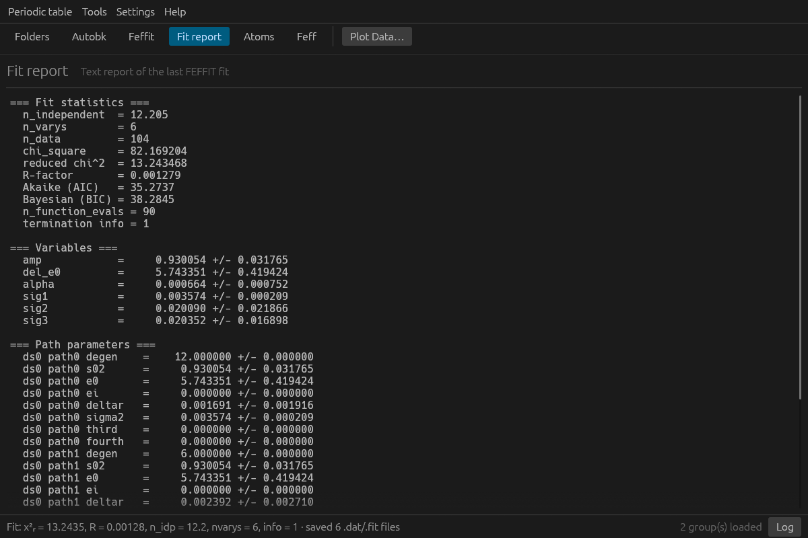

- **Save result**: 현재 Fit report 텍스트를 파일로 저장합니다. **Load result**는
  저장해 둔 텍스트 파일을 팝업 창에 보여 줍니다(피팅 설정을 복원하지는
  않습니다). **Load inp**는 예전 feffit `.inp`를 읽습니다.
- **Send to Plot Data**: data·fit 곡선을 Plot Data 창으로 보냅니다.
- **Batch…**: 같은 모델을 체크한 여러 group에 한꺼번에 적용하고 결과를 표로
  모읍니다.

## 9. FEFF 경로 만들기 (Atoms → Feff 탭)

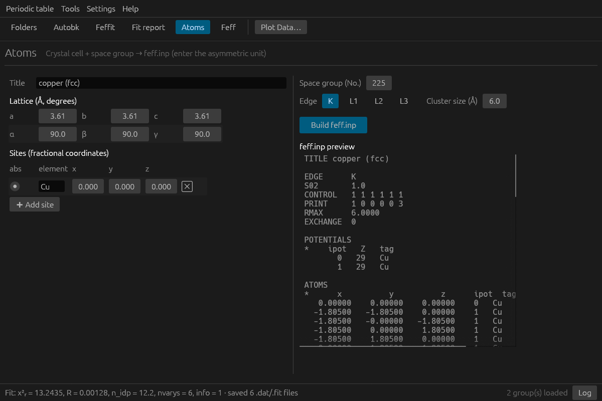

**Atoms** 탭에 결정 구조를 넣습니다. 격자 상수(a, b, c, α, β, γ), 공간군 번호,
비대칭 단위 원자(원소, 분율 좌표)와 흡수 원자(abs), 흡수단(K / L1 / L2 / L3),
클러스터 크기. **Build feff.inp**를 누르면 대칭을 전개해 `feff.inp`를 만들고
오른쪽에 미리 보여 줍니다.

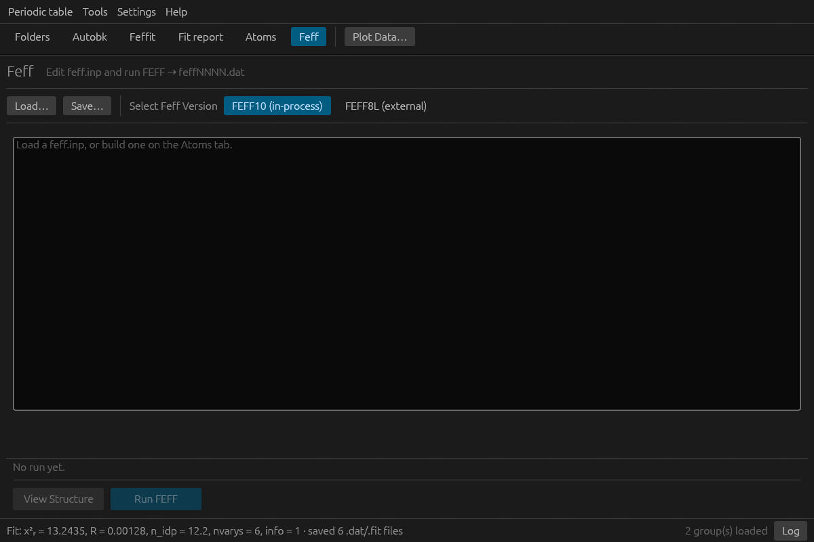

**Feff** 탭에서는 그 `feff.inp`를 고쳐 쓰거나(**Load…** / **Save…**) FEFF 버전을
고른 뒤 **Run FEFF**를 누릅니다. 끝나면 `feffNNNN.dat` 경로 파일이 생기고, 이것을
Feffit 탭의 **Add feff path…**로 불러옵니다. **View Structure**는 클러스터와
경로를 3D로 보여 줍니다.

## 10. In-situ 맵 (스캔 시리즈)

Tools › **In-situ map (scan series)…** 또는 Autobk 탭의 Analysis 묶음에서 엽니다.
시리즈 스캔을 한 번에 열어 group으로 만들고 배경 제거까지 끝낸 상태에서
시작합니다.

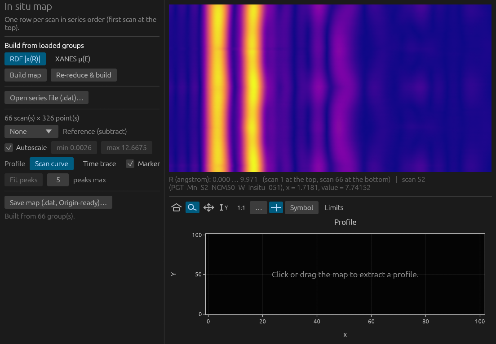

- **Build from loaded groups**: `RDF |χ(R)|`은 group마다의 |χ(R)|을, `XANES μ(E)`는
  정규화 μ(E)(norm 또는 flat)를 공통 에너지 격자에 올려 한 줄씩 쌓습니다. 첫
  스캔이 맨 위입니다. **Build map**으로 그리고, Autobk 파라미터를 바꾼 뒤에는
  **Re-reduce & build**로 재처리와 맵 생성을 한 번에 합니다.
- **Open series file (.dat)…**: 예전 BL10C 프로그램이 내보낸 시리즈 파일
  (`RDF.dat`, `XANES.dat`, `*_Sub_*.dat`)과 이 창의 Save map 결과를 그대로 엽니다.
- **Reference (subtract)**: 기준 스캔을 골라 모든 줄에서 빼면 변화량만 보입니다.
- **Autoscale** 또는 min / max로 색 범위를 정합니다.

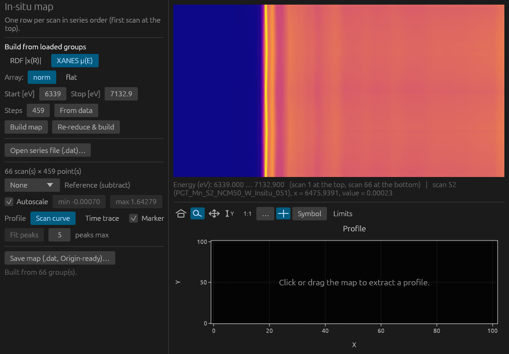

맵을 클릭하거나 드래그하면 아래에 **Profile**이 나옵니다. `Scan curve`는 클릭한
스캔의 곡선, `Time trace`는 클릭한 x 위치의 값이 스캔에 따라 변하는 추이입니다.
**Marker**를 켜면 맵에 선택 위치가 선으로 표시됩니다.

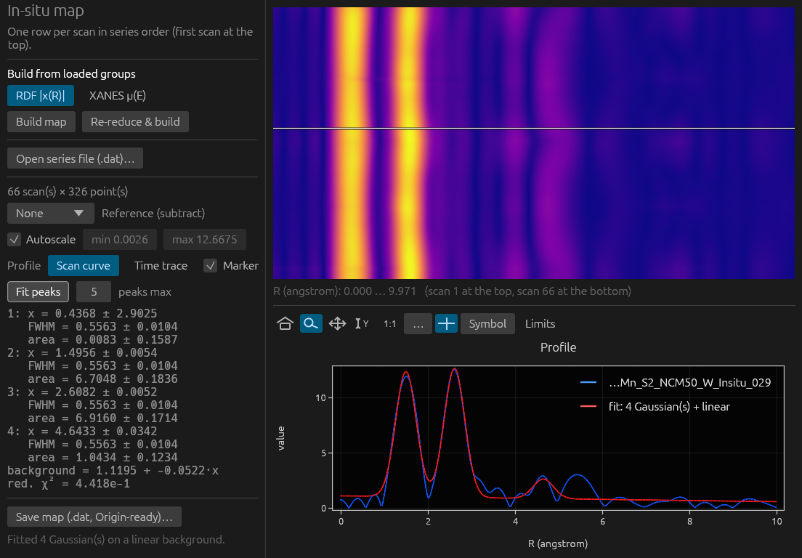

**Fit peaks**는 프로파일에 Gaussian 피크를 맞춥니다(선형 배경, 모든 피크의
FWHM 공유, 최대 개수는 peaks max). 피크 위치·FWHM·면적과 오차가 왼쪽에 나옵니다.
**Save map (.dat, Origin-ready)…**는 보이는 맵을 탭 구분 행렬로 저장합니다.

## 11. 그 밖의 도구 (Tools 메뉴)

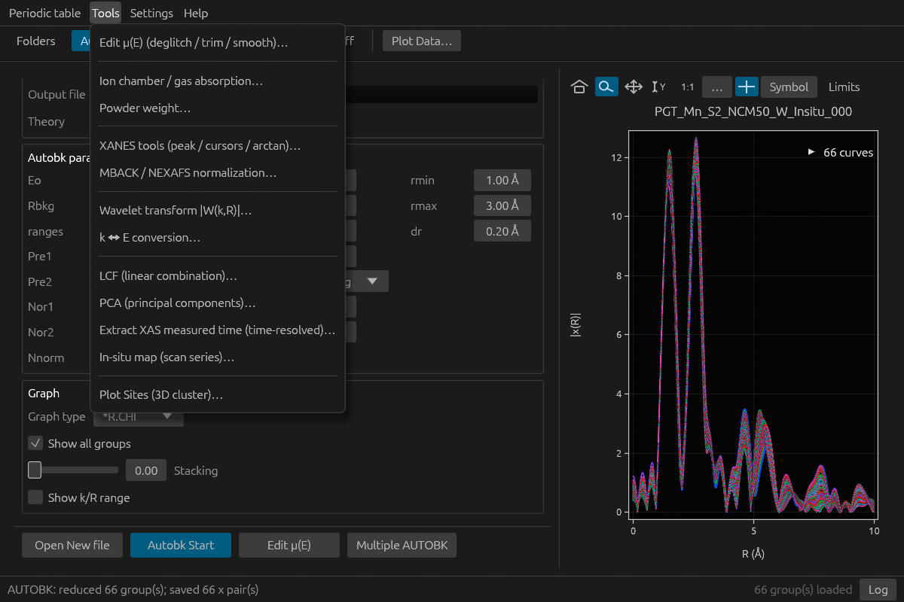

| 메뉴 | 하는 일 |
| --- | --- |
| Edit μ(E) | 6장의 편집 창 |
| Ion chamber / gas absorption | 이온 챔버 가스·압력에 따른 흡수율과 플럭스 |
| Powder weight | 목표 흡광도에 필요한 분말 시료 무게 |
| XANES tools | 피크·골·반높이 커서, arctangent 단계 빼기 |
| MBACK / NEXAFS normalization | 원자 산란 인자 표에 맞춘 정규화 |
| Wavelet transform | χ(k)의 \|W(k,R)\| 웨이블릿 맵 |
| k ↔ E conversion | k와 에너지 환산 |
| LCF | 표준 스펙트럼의 선형 결합 피팅 |
| PCA | 주성분 분석 |
| Extract XAS measured time | 시간 분해 파일들의 측정 시각 표 |
| In-situ map | 10장의 맵 창 |
| Plot Sites | feff.inp 클러스터 3D 보기 |

**Periodic table** 메뉴는 원소를 누르면 질량, 밀도, 흡수단, 형광선 에너지를 보여
줍니다.

## 12. 설정

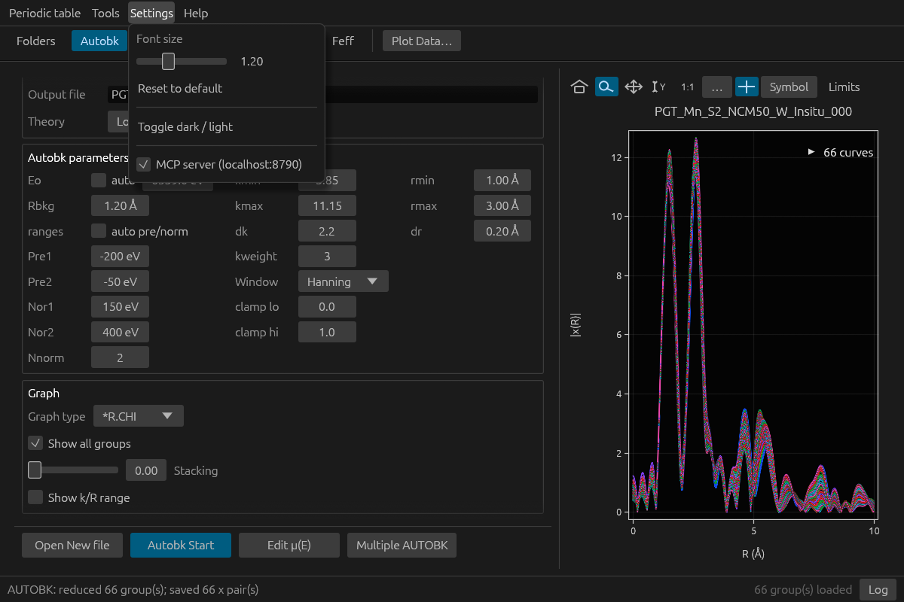

- **Font size** 슬라이더와 **Toggle dark / light**(어두운·밝은 테마). 글꼴, 테마,
  작업 폴더, 창 크기는 저장되어 다음 실행 때 복원됩니다.
- **MCP server**: 체크하면 `localhost:8787`에 제어 서버가 열립니다. Claude Code 같은
  AI 에이전트가 이 서버로 데이터 열기, 파라미터 설정, AUTOBK, 피팅, 화면 캡처를
  대신 할 수 있습니다. 실행 시 `xafsview --mcp [포트]`로도 켤 수 있습니다. 이
  설정만은 실행할 때마다 다시 켭니다.

## 13. 출력 파일 이름

group 이름이 `NAME_000`일 때:

| 파일 | 내용 |
| --- | --- |
| `NAME_000.xmu` | μ(E) |
| `NAME_000k.chi`, `NAME_000r.chi` | χ(k), χ(R) |
| `NAME_000e.bkg`, `NAME_000k.bkg` | 배경 (E 축, k 축) |
| `NAME_000k.dat`, `NAME_000r.dat`, `NAME_000q.dat` | 피팅에 쓴 데이터 변환 |
| `NAME_000k.fit`, `NAME_000r.fit`, `NAME_000q.fit` | 피팅 모델 |

모두 탭으로 구분된 텍스트라 Origin이나 Excel에서 바로 열립니다.
